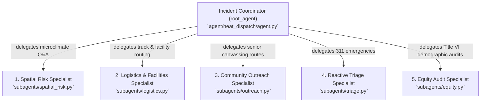

# AGENTS.md: Multi-Agent Architecture & Specialist Roster

This document defines the autonomous multi-agent hierarchy for Team Scarlett's Chicago Heat Dispatch System (Agents for Impact 2026, Challenge 1).

All contributors and AI coding assistants must adhere to this topology and communication contract when building features.

---

## 1. System Topology

We use a **1 Incident Coordinator + 5 Specialist Subagents** hierarchy built on the Google Agent Development Kit (ADK) and deployed to Vertex AI Reasoning Engine:



---

## 2. Specialist Roster & Responsibilities

| Agent Name | Source File | Tools Available | Core Responsibility |
| :--- | :--- | :--- | :--- |
| **`heat_dispatch_agent`** *(Coordinator)* | `agent/heat_dispatch/agent.py` | `get_forecast_high`, `heat_risk_for_forecast`, `locate_place`, `build_dispatch_plan`, Toolbox tools | High-level orchestration; executes full morning dispatch pipeline (`rank_priority_sites` ➔ `rank_wellness_check_tracts` ➔ `equity_audit` ➔ `build_dispatch_plan`); routes specialized inquiries to subagents. |
| **`spatial_risk_agent`** | `subagents/spatial_risk.py` | `get_forecast_high`, `heat_risk_for_forecast`, `locate_place`, `predict_site_heat` | Evaluates ambient NWS weather; runs BigQuery ML physical microclimate offset model; explains feature attributions (lake effect, tree canopy, housing era, building density). |
| **`logistics_agent`** | `subagents/logistics.py` | `locate_place`, `nearest_cooling_facilities`, `rank_priority_sites` | Siting hydration trucks at high-risk intersections; pairs stops with nearest CPL cooling libraries (hours extension) and CPS High Schools (emergency gym cooling). |
| **`outreach_agent`** | `subagents/outreach.py` | `locate_place`, `who_lives_near`, `rank_wellness_check_tracts` | Identifies vulnerable Census tracts with dense elderly (65+), zero-vehicle, and poverty populations for door-to-door wellness canvassing. |
| **`triage_agent`** | `subagents/triage.py` | `locate_place`, `nearest_cooling_facilities`, `predict_site_heat` | Midday disruption response: geocodes 311 heat calls or cooling center AC failures; calculates real-time field asset rerouting orders. |
| **`equity_agent`** | `subagents/equity.py` | `equity_audit` | Compares proposed site demographics against Chicago citywide ACS baselines (Title VI fairness guarantee). |

---

## 3. Communication & Execution Rules

1. **Session State Persistence (`stash_tool_results`):**
   * Every subagent factory must receive and bind `after_tool_callback=stash_tool_results`.
   * When any subagent calls `rank_priority_sites`, `rank_wellness_check_tracts`, or `equity_audit`, the rows are stashed in `tool_context.state`.
   * `build_dispatch_plan` retrieves these exact rows from session state so the LLM cannot hallucinate coordinates or statistics.

2. **Spatial Safety Guard (`guard_point_tools`):**
   * Every subagent must receive `before_tool_callback=guard_point_tools`.
   * Queries containing coordinates outside the City of Chicago bounding box (`41.60, 42.10, -87.95, -87.50`) are rejected immediately before reaching BigQuery.

3. **No Transfer Loops:**
   * Subagents must **never** call `transfer_to_agent`. Once transferred to a specialist, that specialist answers the operator directly in plain, actionable language.
   * The Incident Coordinator (`root_agent`) executes multi-tool pipeline flows directly instead of chaining multiple subagent transfers for batch plans.

---

## 4. REST API & Human-in-the-Loop Approval Lifecycle

The agents recommend; humans authorize. The lifecycle is managed by the FastAPI service in `api/`:

```
POST /api/dispatches/proposals     Agent submits structured plan -> status: PENDING_REVIEW
POST /api/dispatches/approve       Operator selects stops & signs HMAC -> status: APPROVED
GET  /api/dispatches/active        Field crews and frontend map read active dispatches
PATCH /api/dispatches/{id}/override Triage agent or operator reroutes a stop midday
POST /api/dispatches/{id}/close    Stand down dispatch at end of shift -> status: CLOSED
```

---

## 5. Mock & Demo Data Assets

* **`client/initial_dispatch_state.json`**: Pre-computed baseline 102°F dispatch plan (3 trucks, 4 canvass teams, 3 libraries, 3 high school gyms, 10 map pins, and Title VI equity multipliers). Bundled by the frontend to render the UI **instantly (sub-second)** on load.
* **`client/mock_311.json`**: 3 realistic midday heat emergencies (Senior AC failure in Chatham, Toman Library power outage, Transit heat distress) wired to one-click triage buttons.
