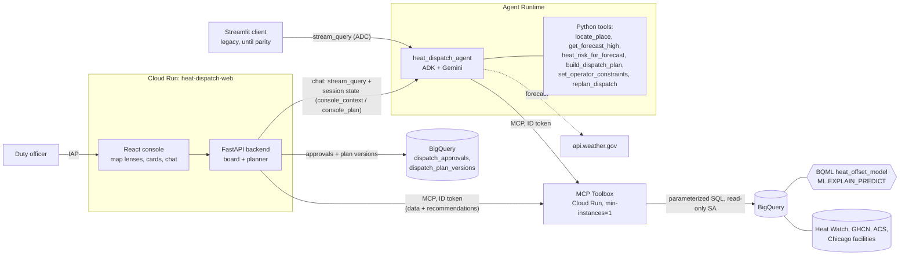

# Architecture and decisions

**Track:** Today. **City:** Chicago. **User:** an emergency-management duty officer who must decide, by tomorrow's
heat, where hydration trucks go, who gets wellness checks, and which libraries stay open longer.

## Why each piece exists
| Piece | Job | Why this and not something simpler |
|---|---|---|
| **BQML `LINEAR_REG`** on grid cells | Predict the *offset* (°F hotter than the Chicago average) for every ~330 m cell, driven or not | The README's requirement; free-tier; supports `ML.EXPLAIN_PREDICT`; attributions are speakable |
| **MCP Toolbox** (11 SQL tools) | The agent's only path to BigQuery | We *consume* an MCP server (required) *and* define our own tools (required). Ranking, explanation, audit are parameterized SQL, so the LLM never writes SQL |
| **Python tools** | Things that are not one query: forecast + offset arithmetic, place lookup, assembling the dispatch sheet | The README: "the work that isn't a single query" |
| **Stash callback + `build_dispatch_plan`** | The sheet is built from stored tool output | The language model cannot alter a coordinate or a count; it only writes prose around them |
| **Heat Dispatch Console** (`web/`) | The duty desk's screen: 6 map lenses, City sites, recommendation cards with Approve / Skip, operator chat | Concept D (`docs/mockups/concept-d`). React for a stateful board; FastAPI so the browser never touches BigQuery or Toolbox |
| **Shared planner** (`agent/heat_dispatch/planner.py`) | Turns Toolbox rows + constraints + approvals into plan items, a diff, and capacity un-approvals | One deterministic implementation for slider re-plans (backend) and chat re-plans (agent). Stdlib only, so the backend loads it by path without the ADK agent |
| **Console tools** (`console.py`) | `set_operator_constraints` + `replan_dispatch`: the agent changes constraints, re-plans from fresh Toolbox rows, writes `console_plan` to session state | The backend reads the plan from session state after the turn, so a number never passes through model text |
| **Approvals in BigQuery** | Every approve / un-approve / skip / capacity un-approval: who, when, item, plan version; every plan version's full payload | An audit trail the desk can query; the web identity may write only these two tables |
| **Guard callback** | Refuses points outside Chicago without calling a tool | A deterministic failure path, not a prompt hope |
| **Facilities (City of Chicago)** | 79 libraries, senior centers, colleges... with hours | Bring-your-own-data; turns "hot" into "hot and far from anywhere cool" |
| **Community areas (City of Chicago)** | 77 neighbourhood polygons | Clips the grid to the city and names every stop |
| **OpenStreetMap (ODbL)** | buildings, green, paved-use land, roads within 300 m | Built-environment features; attribute (c) OpenStreetMap contributors |

## Decisions we can defend
1. **Predict the offset, not the temperature.** Single afternoon, one-hour window: differences are purely spatial.
   Expected air temp at a site = forecast + offset, computed by `heat_risk_for_forecast`.
2. **Physical features only in the model** (distance to lake, to the Loop, density, housing age). Demographics are
   added *after* (vulnerability index) and then *audited*, so the audit is not circular. Race is not loaded or used.
3. **Spatial hold-out.** ~20% of 2.7 km superblocks are held out whole; a random row split would leak because
   neighbouring cells share a temperature. `05_evaluate.sql` compares against "always predict zero".
4. **Vulnerability = 65+, no car, poverty**, equal-weight percentile ranks, missing → city median. No outcome tuning.
5. **Priority = (heat_weight·heat + (1-heat_weight)·vulnerability) × (0.6..1.0 by distance from indoor cooling).**
   `heat_weight` is a tool parameter: the officer can move it and the equity audit shows the consequence.
6. **Spacing:** best cell per ~1.7 km block, so five trucks are not parked on one hot corner.
7. **Interface: the Heat Dispatch Console** (`web/`, React + FastAPI on Cloud Run, behind IAP). It replaced Streamlit
   (`client/` is kept until parity). The browser talks only to the backend; data and recommendations come from Toolbox
   tools (`tract_map_layer`, `list_sites`, the ranking tools), chat goes to the agent. Scoring still runs
   `ML.EXPLAIN_PREDICT` in BigQuery. `adk web` is kept for debugging.
8. **Toolbox on Cloud Run with min-instances=1, private.** No cold start on the first (demo) request; only the agent's
   identity can invoke it; the Toolbox SA is read-only on the dataset (IAM, not prompt, enforces read-only).
9. **Chat re-plans through session state, not text.** Before each turn the backend writes `console_context` (plan
   version, day, constraints, approvals, skips, item keys) into the session with ADK's session service (Vertex AI
   Sessions when deployed: the store Agent Runtime uses). The agent's `replan_dispatch` writes `console_plan` (with the
   turn id); the backend adopts it only if the turn id matches, and re-runs the planner if the board moved meanwhile.
10. **Approvals stay pinned across re-plans.** When capacity drops below what is approved, the lowest-priority
    approvals are un-approved and the operator is told which (logged as `auto_unapprove` by `system`).
11. **Console mapping of the mockup's controls.** Rank-by presets set `heat_weight` (balanced 0.5, vulnerable-first 0.2,
    heat-only 1.0). The hot cutoff is a minimum modelled offset (`min_offset`). Wellness = top tracts from
    `rank_wellness_check_tracts`; libraries = open-that-weekday branches scored by ranked tracts within 1.2 km not
    already given a team; trucks = `rank_priority_sites` cells outside wellness tracts. The mockup's 65+-share and
    walking-radius sliders had no backing in our data and were dropped.

## Honest limits (say these in the pitch)
- Heat Watch is **one afternoon driven by volunteers**; the model has seen one weather pattern and fixed routes.
- **Weak model, stated plainly.** On spatially held-out blocks the physical-feature model gets r2 ~0.26 (RMSE 2.06F vs 2.41F
  for "always predict the average"). Its offsets are small (top sites about +1.4F) next to the 20F spread of raw readings.
  Diagnostics (linear models, same held-out blocks): land cover alone r2 0.01; a plain lat/lon quadratic trend 0.50;
  physical + trend 0.51. So most of the signal in this campaign is a smooth geographic gradient (lake effect, but possibly
  also the order in which volunteers drove their routes), and local land cover barely adds to it. Nothing was tuned on the
  held-out blocks. Ranking is therefore "relatively hotter and more vulnerable", not a measured temperature.
- Lakefront geometry is hand-traced (~300 m); the Loop is a point. Both are proxies.
- Density is estimated from tract centroids, so it is coarse at tract borders.
- ACS demographics are tract-level 5-year estimates; a tract is counted whole in `who_lives_near`.
- The offset says *where relatively hotter*, not *what it feels like*: heat index needs humidity, passed separately.
- Facility hours are a snapshot; holiday closures are free text. The agent says "confirm".
- We cannot simulate an intervention's effect (no data), and we do not claim to.
- The console keeps the live board in memory (Cloud Run `max-instances=1`); BigQuery holds every version and is
  reloaded on start. Two operators see one shared board; there is no per-operator draft.
- Tract outlines come from `bigquery-public-data.geo_census_tracts.census_tracts_illinois`; a tract whose geometry
  does not join (vintage mismatch with ACS 2022) is simply not drawn.

## Verified live (project qwiklabs-gcp-04-3e58e01275b8)
| Step | Result |
|---|---|
| Data load | Chicago: 48,855 readings (22F spread, no timestamps as expected), 1,627 tracts, 13 stations from 2019 |
| Model pipeline 01-06 | all checks PASS; 5,053 city cells (1,649 measured, 3,313 never driven) |
| 9 Toolbox tools | run live, including ML.EXPLAIN_PREDICT; deployed Toolbox (Cloud Run, private) answers over MCP |
| Agent on Agent Runtime | calls Toolbox with its own ID token; answers with neighbourhood, reasons and equity audit |
| Client on Cloud Run | 200 with identity token, 403 without |
| Console (`web/`) | offline only so far: `make test` (planner, console tools, backend with fake Toolbox/agent, React flows); not yet deployed |

Reliability on the deployed agent (canned "plan tomorrow" prompt): 1/3 and 1/6 before fixes, 12/12 after (event-loop, same-step race, transfer ping-pong; see CLAUDE.md gotchas).

Bugs the live run caught: MCP returns BigQuery structs as `[name, value]` pairs not objects; the Heat Watch footprint
includes suburbs (Berwyn), so cells are clipped to the 77 community areas; O'Hare ranked first until the default density
floor was raised to 3,000 people/km2.

## Judging map
| Dimension | Where to look |
|---|---|
| Impact & insight | dispatch sheet (stand-on coordinates, who is nearby, nearest cooling, library hours) |
| Technical execution | `toolbox/tools.yaml` (MCP), `sql/04_train_model.sql` (BQML), `agent/heat_dispatch/` (ADK), `scripts/deploy_*.sh` (Agent Runtime) |
| Rigor & judgment | `sql/05_evaluate.sql`, `sql/06_validate.sql`, `equity_audit` tool, this file's limits |
| Craft | `web/` (console), `docs/mockups/concept-d` (the design it implements), `docs/` |
